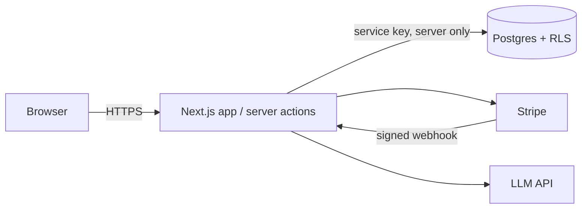

# Threat model: {{PROJECT}}

_Last updated: YYYY-MM-DD by Sentinel_

## Assets
What attackers want: user data (PII), credentials and sessions, payments and entitlements, admin capabilities, API keys and AI budget, availability.

## Actors
Anonymous visitor · authenticated user · user of another tenant · admin · third-party service (webhooks) · malicious content (prompt injection, uploaded files).

## System & trust boundaries

## Threats (STRIDE)
| Boundary | Threat | S/T/R/I/D/E | Likelihood | Impact | Mitigation | Status |
|---|---|---|---|---|---|---|

## Residual risks & assumptions
